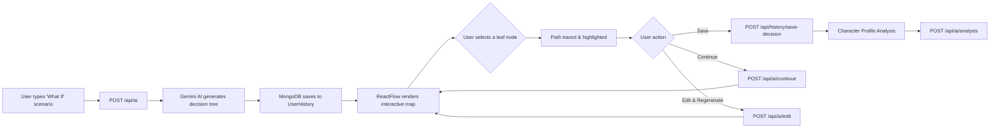

<p align="center">
  
</p>

<h1 align="center">What-If Map</h1>

<p align="center">
  <strong>A Psychology-Powered Decision Visualization Platform for Overthinkers</strong>
</p>

<p align="center">
  <em>Stop spiraling. Start mapping. Transform your "what ifs" into structured clarity.</em>
</p>

<p align="center">
  
  
  
  
</p>

---

## The Psychology Behind What-If Map

**Overthinking** is one of the most common cognitive patterns affecting mental well-being. It manifests as an endless loop of "what if" scenarios — replaying decisions, imagining worst-case outcomes, and feeling paralyzed by the weight of unmade choices. Research in cognitive behavioral therapy (CBT) shows that **externalizing thoughts** — getting them out of your head and into a visual, structured format — is one of the most effective techniques for breaking the rumination cycle.

**What-If Map** is built on this principle. Instead of letting hypothetical scenarios spiral endlessly inside your mind, you type them out — and the AI transforms them into a **structured decision tree** you can see, explore, branch, and analyze. The act of *seeing* your anxious thoughts mapped out as logical pathways provides **immediate cognitive relief**:

- **Externalization**: Moving abstract worries from your mind onto a visual canvas reduces their emotional intensity.
- **Structured Exploration**: Each "what if" becomes a concrete node with defined outcomes, replacing vague dread with actionable clarity.
- **Bounded Thinking**: The decision tree has endpoints — unlike the infinite loops in your head. You can see where each path leads and that *every* scenario eventually resolves.
- **Agency & Control**: By selecting paths, saving decisions, and continuing stories, you shift from a passive worrier to an active decision-maker.
- **Pattern Recognition**: The AI Character Profile analyzes your decision-making patterns over time, helping you understand your own cognitive tendencies — whether you're risk-averse, a calculated risk-taker, or a validation seeker.

> **Disclaimer**: What-If Map is a cognitive wellness tool designed to provide temporary relief and structured thinking exercises. It is not a substitute for professional mental health treatment. If you are experiencing persistent anxiety or mental health challenges, please consult a qualified mental health professional.

---

## Features

### AI-Powered Scenario Generation
Type any "what if" scenario — from life decisions to hypothetical thought experiments — and watch as Gemini AI generates a **complete multi-branch decision tree** with 2–5 primary paths, nested subpaths, and interconnected outcomes.

### Interactive Decision Map (React Flow)
Explore your scenarios through a **fully interactive graph visualization** powered by React Flow. Click on leaf nodes to trace decision paths back to the root, highlight branches with golden glow effects, and navigate with pan/zoom controls and a minimap.

### Edit & Regenerate Scenarios
Made a new realization? Use the **Edit & Re-Explore** panel to modify your original prompt and regenerate scenarios:
- **No path selected**: Regenerates the entire decision tree from scratch.
- **Path selected**: Edits only the downstream nodes along your chosen path (keeping the root node intact), preserving unrelated branches.

### Continue Story / Path
Reached the end of a branch and want to explore further? The **Continue Story** feature extends any leaf node with 2–4 new AI-generated continuation outcomes, growing your decision tree deeper.

### Save & Undo Decisions
Lock in your chosen decision path with **Save Chosen Path**, which persists your selection to MongoDB. Changed your mind? **Undo Save Decision** reverses it instantly.

### AI Strategic Advice Panel
Every scenario comes with an **AI Recommendation Engine** that identifies the optimal decision lineage, highlights recommended paths with green edges, and provides written strategic advice explaining *why* that path is optimal.

### Character Profile & Behavioral Analysis
The platform builds a **psychological decision-making profile** based on your saved decisions over time:
- **Risk Tolerance**: Risk-Averse, Balanced, or High-Risk
- **Decision Style**: e.g., "Calculated Risk-Taker", "Cautious Planner", "Validation Seeker"
- **Traits Summary**: AI-generated behavioral analysis noting patterns and shifts in your decision-making over time

### User Profile Dashboard
A comprehensive profile page displaying:
- Account information and session stats
- Total scenarios created, decisions saved, and AI acceptance rate
- Full history of saved decision paths with search and filter
- One-click re-analysis of your character profile

### Dark / Light Theme Toggle
Seamlessly switch between dark and light modes with an animated sun/moon toggle. All UI components, panels, and the ReactFlow canvas adapt dynamically.

### OAuth Authentication
Secure sign-in via Google OAuth using NextAuth.js. All scenario data is persisted per-user in MongoDB.

---

## Tech Stack

| Layer | Technology |
|---|---|
| **Framework** | Next.js 16 (App Router) |
| **Frontend** | React 19, React Flow (`@xyflow/react`) |
| **Styling** | Vanilla CSS (Glassmorphism, CSS Variables, Animations) |
| **AI Engine** | Google Gemini API (`@google/genai`) with multi-model fallback |
| **Database** | MongoDB Atlas via Mongoose |
| **Authentication** | NextAuth.js (Google OAuth) |
| **Animations** | GSAP, CSS Keyframes, Styled Components |
| **Icons** | Lucide React |

---

## Architecture

```
what-if-map/
├── app/
│   ├── api/
│   │   ├── ai/
│   │   │   ├── route.js              # POST — Generate new scenario tree
│   │   │   ├── edit/route.js         # POST — Edit/regenerate scenarios
│   │   │   ├── continue/route.js     # POST — Continue story from leaf node
│   │   │   └── analysis/route.js     # GET/POST — Character profile analysis
│   │   ├── auth/[...nextauth]/       # NextAuth OAuth handlers
│   │   ├── history/
│   │   │   ├── route.js              # GET — Fetch user history list
│   │   │   ├── latest/route.js       # GET — Fetch latest scenario
│   │   │   ├── specific/[object_id]/ # GET — Fetch scenario by ID
│   │   │   └── save-decision/        # POST/GET/DELETE — Decision persistence
│   │   └── user/profile/route.js     # GET — User profile + stats
│   ├── components/
│   │   ├── ScenarioMapView.js        # Main ReactFlow interactive map
│   │   ├── GlassPromptEditor.js      # Floating prompt editor + regeneration
│   │   ├── AIAdvicePanel.js          # AI recommendation sidebar panel
│   │   ├── SelectedPathPanel.js      # Path selection + save/undo/continue
│   │   ├── MapNavbar.js              # Map view navigation bar
│   │   ├── ThemeToggle.js            # Dark/light mode animated switch
│   │   ├── DotGrid.js               # Interactive background grid
│   │   ├── CinematicLogoReveal.js    # App loading intro animation
│   │   ├── customNode.js             # Custom ReactFlow node component
│   │   └── ...loaders                # Page-specific loading skeletons
│   ├── hooks/
│   │   ├── userContext.js            # Global state (nodes, edges, prompt)
│   │   └── ThemeContext.js           # Theme state provider
│   ├── hi/
│   │   ├── page.js                   # Latest scenario map view
│   │   └── [object_id]/page.js       # Specific scenario map view
│   ├── login/page.js                 # OAuth login page
│   ├── profile/page.js               # User profile dashboard
│   ├── page.js                       # Landing page + scenario input
│   ├── layout.js                     # Root layout with providers
│   └── globals.css                   # Global design system + theme variables
├── lib/
│   ├── aiService.js                  # Shared AI generation functions
│   ├── auth.js                       # NextAuth configuration
│   ├── connectDb.js                  # MongoDB connection utility
│   └── runCharacterAnalysis.js       # Character profile AI analysis
├── models/
│   ├── ReactFlowMapSchema.js         # Gemini structured output schema
│   ├── UserHistory.js                # User scenario history model
│   ├── SavedDecision.js              # Saved decision paths model
│   └── charchterSchema.js            # Character profile model
└── public/
    └── logo.svg                      # Brand logo
```

---

## Data Flow



---

## Database Schema

### UserHistory
Stores all scenario exploration history per user:
- `email` — User identifier (unique)
- `history[]` — Array of scenario documents
  - `userPrompt` — Original "what if" question
  - `ai_response` — Complete AI-generated decision tree
    - `output_1_paths` — ReactFlow node array
    - `output_2_flow_edges` — ReactFlow edge array
    - `output_3_recommendation_and_advice` — Strategic advice

### SavedDecision
Stores user-committed decision paths:
- `email` — User identifier (unique)
- `savedDecisions[]` — Array of saved paths
  - `obj_id` — Reference to UserHistory scenario
  - `userPrompt` — Scenario prompt
  - `chosenPath[]` — Ordered array of path steps (pathId, pathName, story, category)
  - `acceptedAiRecommendation` — Whether the user followed AI advice

### CharacterProfile
AI-generated behavioral profile:
- `email` — User identifier
- `riskTolerance` — "Risk-Averse" | "Balanced" | "High-Risk"
- `decisionStyle` — Behavioral label (e.g., "Calculated Risk-Taker")
- `traitsSummary` — 2–3 sentence behavioral analysis
- `analyzedDecisionIds` — Snapshot of decision IDs used for last analysis (change detection)

---

## AI Model Strategy

What-If Map uses a **cascading multi-model fallback** strategy with Google Gemini:

```
gemini-flash-latest → gemini-3.6-flash → gemini-3-preview → gemini-3.5-flash → gemini-2.5-flash → gemini-2.5-pro
```

If the primary model fails (rate limits, outages), the system automatically tries the next candidate. All AI calls use **structured JSON output** with predefined response schemas to ensure consistent, parseable decision trees.

---

## Getting Started

### Prerequisites
- Node.js 18+
- MongoDB Atlas cluster
- Google Cloud project with OAuth credentials
- Google Gemini API key

### Environment Variables

Create a `.env` file in the project root:

```env
GEMINI_API_KEY=your_gemini_api_key
MONGODB_URI=your_mongodb_atlas_connection_string
NEXTAUTH_SECRET=your_nextauth_secret
NEXTAUTH_URL=http://localhost:3000
GOOGLE_CLIENT_ID=your_google_oauth_client_id
GOOGLE_CLIENT_SECRET=your_google_oauth_client_secret
```

### Installation

```bash
# Clone the repository
git clone https://github.com/Aswin-cs/what-if-map.git
cd what-if-map

# Install dependencies
npm install

# Run development server
npm run dev
```

Open [http://localhost:3000](http://localhost:3000) to explore.

### Production Build

```bash
npm run build
npm start
```

---

## How It Helps Overthinkers

| Overthinking Pattern | How What-If Map Helps |
|---|---|
| **"What if I make the wrong choice?"** | See ALL possible outcomes mapped visually — every path has an ending |
| **"I can't stop thinking about it"** | Externalize the thought loop into a structured decision tree |
| **"Every option feels equally scary"** | AI highlights the recommended path with strategic reasoning |
| **"I keep going back and forth"** | Save your decision path to commit, or undo if you change your mind |
| **"I don't know my own patterns"** | Character Profile reveals your decision-making tendencies over time |
| **"What happens next?"** | Continue any path deeper to explore consequences before committing |

---

## API Reference

| Endpoint | Method | Description |
|---|---|---|
| `/api/ai` | POST | Generate a new scenario decision tree |
| `/api/ai/edit` | POST | Edit/regenerate scenario (full or selected path) |
| `/api/ai/continue` | POST | Continue story from a leaf node |
| `/api/ai/analysis` | GET | Fetch existing character profile |
| `/api/ai/analysis` | POST | Trigger AI character re-analysis |
| `/api/history` | GET | List all user scenario history |
| `/api/history/latest` | GET | Fetch the most recent scenario |
| `/api/history/specific/[id]` | GET | Fetch a specific scenario by ID |
| `/api/history/save-decision` | POST | Save a chosen decision path |
| `/api/history/save-decision` | GET | Check if a decision is saved for a scenario |
| `/api/history/save-decision` | DELETE | Delete a saved decision |
| `/api/user/profile` | GET | Fetch user profile, stats, and saved decisions |

---

## Contributing

Contributions are welcome! Please open an issue or submit a pull request.

---

## License

This project is open source and available under the [MIT License](LICENSE).

---

<p align="center">
  <strong>Built to help overthinkers find clarity</strong>
</p>
